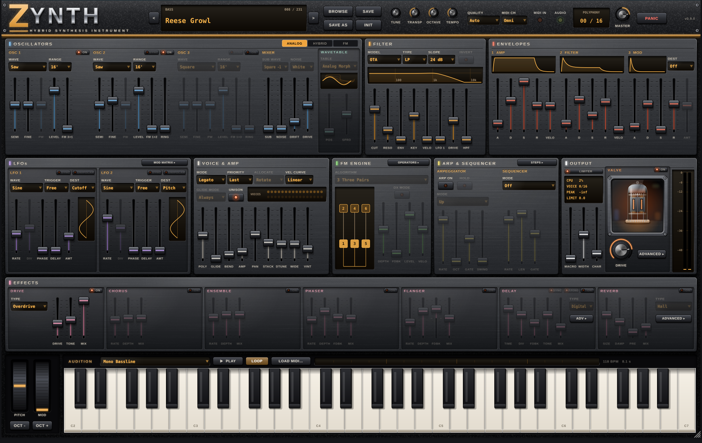

# ZYNTH

A hybrid virtual synthesiser: three band-limited analogue-style oscillators,
wavetables, a six-operator FM engine, four distinct filter models, a full
modulation matrix, arpeggiator, step sequencer and seven effects — on one fixed,
hardware-style front panel of colour-coded faders, with popup editors for the
advanced sections.



| | |
|---|---|
| Formats | Standalone app, VST3 and Audio Unit (macOS universal builds from CI, AU checked with auval) |
| Engine | JUCE-free C++17 library, usable without any GUI |
| Parameters | 333, all host-automatable, one authoritative table |
| Factory library | 227 presets: *ZYNTH Originals* (160, 15 categories) and *Classic Machines* (67 sounds in 20 instrument folders), level-matched by measurement |
| Tests | 41 DSP tests, 19 state/preset/layout/editor tests, a VST3 host test |
| Tested on | Ubuntu 24.04, x86-64, GCC 13.3, CMake 3.28, JUCE 8.0.9 |

## What it does

* **Oscillators** — 3 oscillators (sine, triangle, saw, square, pulse, wavetable),
  PolyBLEP/PolyBLAMP band-limiting including hard sync, audio-rate FM, ring
  modulation, sub-oscillator, white/pink noise, drift, mixer overdrive.
* **Wavetables** — 8 original procedurally generated tables, 32 frames each,
  11 band-limited mipmaps per frame, smooth position scanning and spread.
* **FM** — 6 operators, 16 algorithms, per-operator ratio/fine/level/ADSR,
  velocity sensitivity and keyboard rate/level scaling, operator-6 feedback,
  velocity-to-index. **DX mode** switches to DX7-style maths (logarithmic
  0.75 dB level steps, envelopes that move in decibels, DX index and feedback
  ranges). Runs alone or layered with the
  analogue section (ENGINE: Analog / Hybrid / FM).
* **Filters** — Ladder (transistor ladder with per-stage nonlinearity), OTA
  cascade, SEM-style state variable and K35 Sallen-Key; LP/BP/HP/notch,
  12/24 dB, drive, self-oscillation, plus a pre-filter high-pass.
* **Modulation** — 3 ADSRs, 2 LFOs (7 shapes, tempo sync, delay, retrigger
  modes), 8-slot matrix with 16 sources and 29 destinations, including effects.
* **Voices** — up to 32 voices, poly/mono/legato, note priority, three
  allocation modes, click-free voice stealing, unison up to 8, glide,
  vintage per-voice variation, sustain pedal.
* **Panel** — a photo-real hardware surface: brushed steel plates on a black
  chassis, engraved back-lit legends, moulded fader caps in lit slots, machined
  knobs, LED buttons and smoked-glass displays; one fixed layout of JD-style
  faders with section-coloured caps; the modulation matrix, FM operator detail and sequencer steps open as
  popup editors. Presets are chosen from a Bank > Folder > Preset menu.
* **Performance** — arpeggiator (6 modes, host sync, swing, hold), 16-step
  sequencer (modulation or acid-style note mode with accent and slide),
  MIDI learn, on-screen keyboard with pitch and modulation wheels.
* **Valve stage** — an oversampled valve output stage seen through a glass
  window on the panel (the valve glows brighter as DRIVE goes up): 12AX7,
  12AU7, EL84 push-pull and 6L6 models with bias, supply sag, output-transformer
  warmth and mix.
* **Delay** — six characters: Digital, Tape RE-201, Tape EP-3, Analog DM-2,
  Diffuse and Lo-Fi, with wow, flutter, age, spread and ducking.
* **Reverb** — nine algorithms: Hall, Room, EMT 140 Plate, Echo Chamber,
  Spring, Lexicon 224, Lexicon 480L, Bricasti M7 and Shimmer (original
  algorithms voiced after those units), with decay, low cut, diffusion,
  modulation, early/late and width; delay and reverb each have a menu of
  factory presets.
* **Audition player** — a strip above the keyboard plays a MIDI clip into the
  current sound while you work the panel: 10 built-in loops (basslines, acid,
  lead, chords, e-piano, pads, arpeggio, plucks, brass, bells) or any standard
  MIDI file, merged to one part that plays poly or mono as the patch decides.
* **Effects** — drive (2x oversampled overdrive/distortion/wavefolder),
  phaser, flanger, chorus, string ensemble, ping-pong delay, FDN reverb,
  stereo width and output character, safety limiter.

See [docs/USER_MANUAL.md](docs/USER_MANUAL.md) for how to play it and
[docs/ARCHITECTURE.md](docs/ARCHITECTURE.md) for how it is built.

## Building

Requirements: CMake 3.22+, a C++17 compiler, Git, and JUCE 8 (fetched
automatically, or point `ZSYNTH_JUCE_DIR` at a checkout).

### Linux (built and tested)

```bash
sudo apt install build-essential cmake ninja-build git pkg-config \
    libasound2-dev libjack-jackd2-dev libfreetype-dev libfontconfig1-dev \
    libx11-dev libxext-dev libxinerama-dev libxrandr-dev libxcursor-dev \
    libxcomposite-dev libgl1-mesa-dev
cmake -S . -B build -G Ninja -DCMAKE_BUILD_TYPE=Release
cmake --build build
ctest --test-dir build --output-on-failure
```

Artefacts:

* `build/ZSynth_artefacts/Release/Standalone/ZYNTH`
* `build/ZSynth_artefacts/Release/VST3/ZYNTH.vst3` (copy to `~/.vst3/`)

To build against a local JUCE checkout instead of downloading:
`-DZSYNTH_JUCE_DIR=/path/to/JUCE` (tested with the `8.0.9` tag).

The Linux standalone supports ALSA and JACK (select in *Options > Audio/MIDI Settings*).

### macOS and Windows (documented, not yet built or tested)

The CMake project is cross-platform JUCE and contains no Linux-specific code
paths beyond the ALSA/JACK switches, but **it has not been compiled on macOS or
Windows yet**, so treat these instructions as untested:

```bash
# macOS (Xcode command-line tools): adds the AU format automatically
cmake -S . -B build -G Xcode
cmake --build build --config Release

# Windows (Visual Studio 2022)
cmake -S . -B build -G "Visual Studio 17 2022"
cmake --build build --config Release
```

Code signing, notarisation and installers are not set up (see *Known limitations*).

### Build options

| Option | Default | Meaning |
|---|---|---|
| `ZSYNTH_JUCE_DIR` | empty | Use a local JUCE checkout instead of FetchContent |
| `ZSYNTH_BUILD_PLUGIN` | `ON` | Build the JUCE app/plug-ins (OFF = engine + DSP tests only, no JUCE needed) |
| `ZSYNTH_BUILD_TESTS` | `ON` | Build the test executables |

## Tests and tools

```bash
ctest --test-dir build --output-on-failure          # all suites
build/Tests/ZSynthDspTests [filter]                   # DSP engine (no JUCE)
build/Tests/ZSynthStateTests_artefacts/Release/ZSynthStateTests [filter]
build/Tests/ZSynthBench [seconds]                     # CPU cost per configuration
# Render every factory preset, print levels, write WAVs for listening:
build/Tests/ZSynthStateTests_artefacts/Release/ZSynthStateTests --preset-report /tmp/zsynth-wavs
```

[docs/DSP_TEST_PLAN.md](docs/DSP_TEST_PLAN.md) lists what each test covers, the
measured results, and the manual listening plan.

## Project layout

```
CMakeLists.txt            engine library + options
cmake/ZSynthPlugin.cmake  JUCE targets (standalone, VST3, AU)
Source/
  Parameters/   the parameter table (single source of truth), JUCE layout
  DSP/          JUCE-free engine: Oscillators, Filters, Envelopes, Modulation,
                FM, Wavetable, Voices, Performance (arp/seq), Effects, Engine
  Presets/      preset format, factory bank parser, preset manager
  MIDI/         MIDI learn
  Plugin/       the AudioProcessor shared by every format
  UI/           fixed panel: Layout (canonical spec, activity rules),
                Components (controls, displays, keyboard, browser)
  App/          standalone application
Resources/Presets/FactoryBank.zsbank   ZYNTH Originals bank (plain text)
Resources/Presets/ClassicsBank.zsbank  Classic Machines bank (plain text)
Tests/          test harness, DSP tests, state tests, VST3 host test, benchmark
docs/           architecture, manual, test plan, preset format
```

## Known limitations

These are honest gaps in the current version, not hidden features:

* Built and tested on Linux x86-64 and, through CI, macOS (universal app,
  VST3 and AU; the AU passes `auval`). Windows has not been compiled. Mac
  builds are ad-hoc signed only (not notarised), so macOS asks you to allow
  them once.
* The VST3 was validated with the included JUCE-based host test (load,
  metadata, MIDI rendering, automation, state, editor), not with pluginval or
  in commercial DAWs.
* Sound quality has been verified by measurement (aliasing, frequency accuracy,
  levels, spectra) but **nobody has listened to it yet**: the development
  environment has no audio output. Run the manual listening plan in
  `docs/DSP_TEST_PLAN.md` before release.
* No MPE. Polyphonic aftertouch is supported as a per-voice modulation source.
* FM: 16 algorithms (the DX7 has 32), ratio-based operators only (no
  fixed-frequency mode), keyboard level scaling above C4 only. DX mode follows
  the DX7's maths but is not a bit-exact emulation (no DAC/EG step quantisation).
* The filter models are inspired by classic circuits; none is a validated
  circuit model.
* MIDI CC 11 (expression) is a modulation source, not hard-wired to volume.
* No undo, no "preset modified" indicator, no user wavetable import.
* The arpeggiator and the sequencer's Note mode are mutually exclusive
  (Note mode takes priority).
* Classic Machines presets are original programming *in the style of* those
  instruments using ZYNTH's engine; they are not emulations of the original
  circuits or copies of their factory patches. Instrument names are trademarks
  of their owners, used descriptively; ZYNTH is not affiliated with them.
* The VST3 exposes JUCE's 2048 hidden MIDI-CC proxy parameters in addition to
  the 333 synth parameters (needed for controller input in VST3 hosts).

## Licence

ZYNTH's own source code is provided without a licence choice made yet. It
depends on JUCE, which is dual-licensed (AGPLv3 or the commercial JUCE licence):
see [LICENSES_AND_DEPENDENCIES.md](LICENSES_AND_DEPENDENCIES.md) before
distributing binaries.
